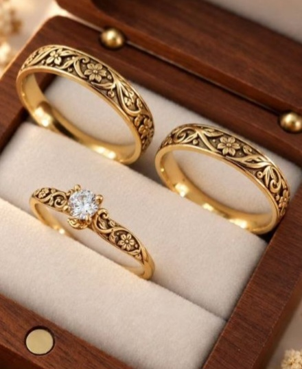

# Floral Gold Rings – 3D Models

Parametric STL models of a floral-engraved gold ring set: two bands and a solitaire engagement ring.

| File | Description |
|---|---|
| `models/ring_1_wide_band.stl` | 19 mm inner diameter, 4.5 mm wide, comfort-fit |
| `models/ring_2_band.stl` | 17 mm inner diameter, 4 mm wide |
| `models/ring_3_solitaire.stl` | 17 mm inner diameter, 5.2 mm round stone, basket + 6 prongs, engraving on shoulders |

Units are millimetres. Open in MatrixGold/Rhino (import STL), Blender, or any slicer.

## Notes
- Engraving: raised vine, leaves, five-petal flowers and buds on a recessed background, with a plain rim. It is parametric and close to, but not identical to, the reference photo. In the viewer the recess is shown dark (oxidised); in the STL it is geometry only.
- The solitaire has a faceted 8-fold brilliant, basket, gallery rail and curved claw prongs.
- These are meshes, not NURBS. Use them as scale/reference geometry and rebuild in Matrix for production.

## Regenerate STLs
```
node tools/export_stl.mjs   # writes full-detail STLs to models/ (single source of truth: site/geometry.js)
node site/test.mjs          # smoke test
```

## Interactive viewer
`site/` is a static page (three.js, no build step): pick a ring, drag sliders (diameter, width, thickness, flowers, engraving depth, stone size, prongs), orbit it, and **Download STL** of the current settings.

- **Local:** `cd site && python3 -m http.server` then open http://localhost:8000
- **GitHub Pages:** Settings → Pages → Source: *GitHub Actions*. The workflow in `.github/workflows/pages.yml` tests and deploys on every push to `site/`.
- **Cloudflare Pages:** connect this repo, framework *None*, build command empty, output directory `site`. Or `npx wrangler pages deploy site`.

## Reference

